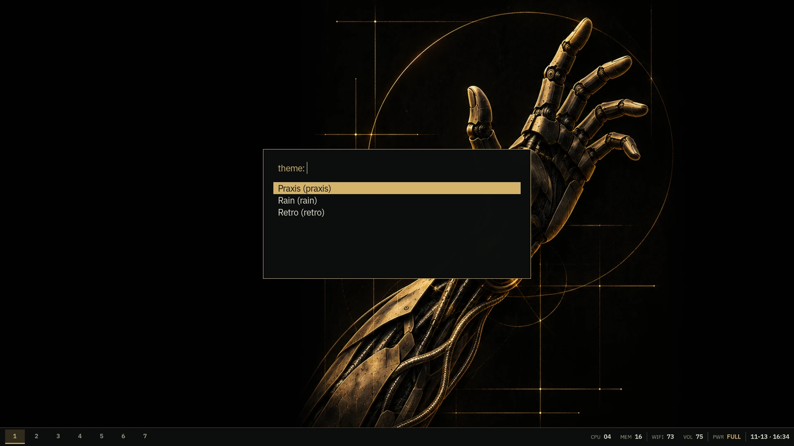
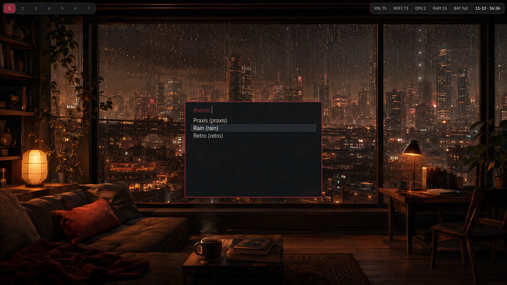
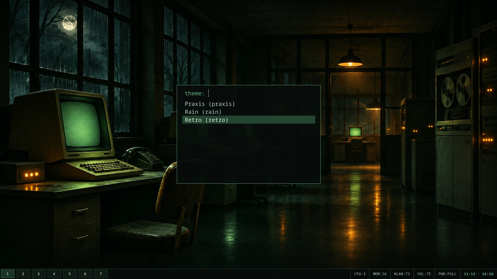

# Sway Noir

A standalone Sway profile with matching themes and Vim-style navigation.

| Praxis | Rain (default) | Retro |
| --- | --- | --- |
|  |  |  |

## Install

**Prerequisites:** Fedora 44 or Fedora 45 Atomic (other distributions are
untested), a **non-root** user, and the cloned repository as working directory.

```bash
git clone --depth 1 https://github.com/mi-uh/sway-noir.git
cd sway-noir
./install.sh --check-deps   # reports missing packages; changes nothing
./install.sh
```

Install the missing **required** packages and repeat the check; optional packages
enable [extra features](#optional-features). **Fedora Atomic:** reboot after
installing packages.

| Option | Effect |
| --- | --- |
| `--profile-only` | Install without prompts or optional changes |
| `--login-session` | Add a login-screen entry for GDM or SDDM; **requires `sudo`** |
| `--set-dark-mode` | Enable dark mode for applications in your user account |
| `--list-deps` | List required and optional software |

Replaced files are backed up in `~/.config/sway-setup-backups`. For other login
managers, add the session entry manually.

## Start

Select **Sway Noir** on the login screen, or run from a text console:

```bash
~/.config/sway-noir/start-sway-noir
```

| Shortcut | Action |
| --- | --- |
| `Super+Enter` / `Super+d` | Terminal / launcher |
| `Super+h/j/k/l` | Focus window |
| `Super+Shift+h/j/k/l` | Move window |
| `Super+r` | Resize mode |
| `Super+1..0` / `Super+n` / `Super+p` | Workspace / next / previous |
| `Super+Shift+t` | Theme and Waybar position menu |
| `Super+Shift+c` | Reload configuration |
| `Super+Shift+x` / `Super+Shift+e` | Lock / exit |
| `Print` / `Shift+Print` | Region / full screenshot |

## Themes

**Super+Shift+t** switches themes without closing applications; a failed switch
keeps the previous theme. The same menu pins Waybar to the top or bottom edge
or restores the theme default. Both choices persist across logins.

Terminal commands inside Sway Noir; add `--no-reload` to `set` or
`bar-position` to save a choice for the next login instead:

```bash
~/.config/sway-noir/session/theme list
~/.config/sway-noir/session/theme set praxis
~/.config/sway-noir/session/theme bar-position top   # default, top or bottom
```

## Personal settings

All personal files live below `~/.config/sway-noir/`. **Updates and uninstall
keep them**; managed files there are replaced on update.

| Purpose | File | Apply with |
| --- | --- | --- |
| Keyboard, monitors, bindings, display performance | `sway/config.d/99-local.conf` ([example](sway/config.d/99-local.conf.example)) | `Super+Shift+c` |
| Startup programs, audio-settings command | `sway/config.d/99-local.conf` | Log out and in |
| Automatic lock (default 10 min), displays off while locked (default 1 min) | `sway/config.d/99-local.conf` | Log out and in |
| Waybar modules and options | `waybar/local.jsonc` ([example](waybar/local.jsonc.example)) | Reselect the theme |
| Own themes | `themes/ID/` | Theme menu |

Never edit generated files in `~/.local/state/sway-noir/current/`.

### Waybar

Create the file once, then add only the settings to change:

```bash
cd ~/.config/sway-noir/waybar && cp -n local.jsonc.example local.jsonc
```

Objects merge with the theme; `modules-left`, `modules-center` and
`modules-right` replace the whole list.

**CPU and NVIDIA GPU temperatures** (off by default):

```jsonc
"modules-right": ["pulseaudio", "network", "battery", "memory", "custom/cpu", "custom/gpu", "tray", "clock"]
```

GPU readings need the driver's `nvidia-smi`; on Fedora it comes from your NVIDIA
driver provider. For another GPU, set `custom/gpu` →
`"exec": "\"$SWAY_NOIR_DIR/session/hardware-status\" gpu 1"`.

### Own themes

Create `~/.config/sway-noir/themes/my-theme/theme.conf`:

```ini
name=My Theme
inherits=praxis
accent=#7496b8
```

`inherits` is optional (default: Rain). Missing values come from the parent
theme. All keys and their defaults: [themes/rain/theme.conf](themes/rain/theme.conf).

Optional templates in the theme folder:

| File | Effect |
| --- | --- |
| `fuzzel/fuzzel.ini.override`, `mako/config.override`, `swaylock/config.override` | Only the changed `key=value` lines; `[sections]` are kept ([example](themes/praxis)) |
| `waybar/config.jsonc` | Appearance overrides; start with `"include": "\"${SWAY_NOIR_THEME_DIR}/waybar/base.jsonc\""` |
| Any other file from [themes/rain/](themes/rain) | Replaces the inherited template |

Waybar stylesheets get the palette with `@import url("colors.css");`. Complete
Waybar configs without `include` use `{{bar_position}}`, `{{bar_margin_top}}`
and `{{bar_margin_bottom}}` to follow the position preference.

Invalid themes are skipped in the menu with a warning; an invalid saved theme
falls back to Rain at login.

## Optional features

| Feature | Required software |
| --- | --- |
| Volume keys | `wpctl` with PipeWire and WirePlumber |
| Audio settings (click on volume) | `pavucontrol` |
| Screenshots | `grim`; region selection also `slurp` |
| Night color | `gammastep` |
| Authentication prompts | `lxqt-policykit-agent` and Qt Wayland |

Screenshots go to `Screenshots/` in your pictures folder (`GRIM_DEFAULT_DIR`
overrides this).

## Update

From the cloned repository:

```bash
git pull --ff-only
./install.sh
```

**Log out and back in afterwards.** Choose the login-screen option again if you
use it. Unchanged files of earlier releases are removed (with backup).

## Uninstall

```bash
./install.sh --uninstall
```

Removes unchanged installed files. Personal settings, changed files, backups,
packages and dark-mode settings stay.

## Development

```bash
bash tests/run.sh
```

See [tests/README.md](tests/README.md).

## License

[MIT](LICENSE). Bundled images were generated with ChatGPT (OpenAI); see
[ASSETS.md](ASSETS.md).
