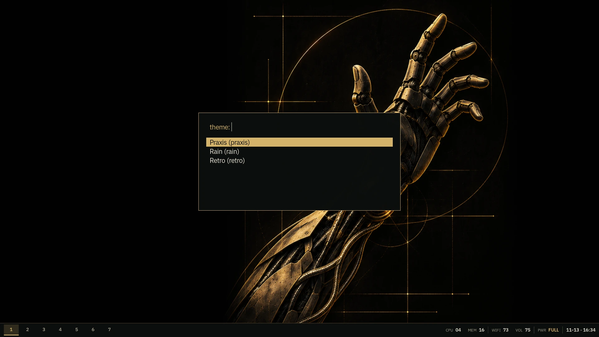
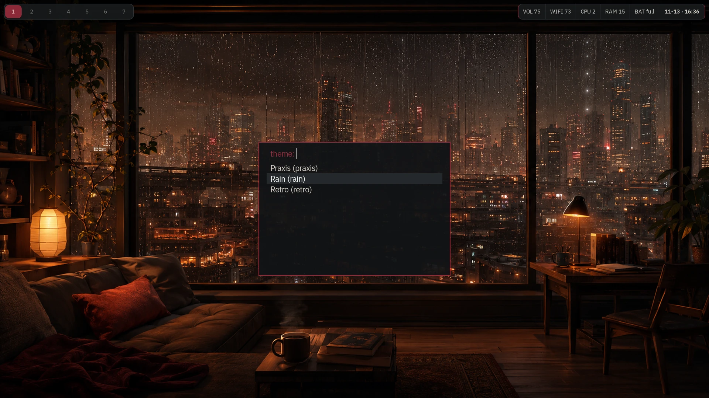
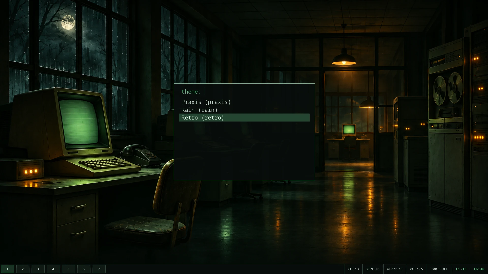

# Sway Noir

A standalone Sway profile with matching desktop themes and Vim-style navigation.

## Screenshots

**Praxis**



**Rain (default)**



**Retro**



## Install

Tested on Fedora 44 and Fedora 45 Atomic.
Other distributions are currently untested.

Run the following steps as a **non-root user**.

### 1. Download Sway Noir

```bash
git clone https://github.com/mi-uh/sway-noir.git
cd sway-noir
```

### 2. Check required software

```bash
./install.sh --check-deps
```

The check reports missing software and prints suggested installation commands.
It does not install anything. Install the missing **required packages**, then
run the check again. **Optional packages** add [extra features](#optional-features)
and can be skipped.

**Fedora Atomic:** Reboot after installing packages before repeating the check.

Once the check passes, continue with installation.

### 3. Install Sway Noir

```bash
./install.sh
```

The installer asks whether to add Sway Noir to your login screen and enable
dark mode for applications in your user account. You can also choose directly:

| Command | Purpose |
| --- | --- |
| `./install.sh --profile-only` | Install without optional changes or prompts |
| `./install.sh --login-session` | Install profile and login-screen entry for GDM or SDDM; requires `sudo` |
| `./install.sh --set-dark-mode` | Install profile and enable dark mode for applications in your user account |
| `./install.sh --list-deps` | List required and optional software |
| `./install.sh --check-deps --set-dark-mode` | Check required software, including dark-mode support; no changes |

Automatic login-screen integration supports GDM and SDDM only. For other login
managers, use `--profile-only` and add the session entry manually.

### File safety

Files replaced during installation or updates are backed up in
`~/.config/sway-setup-backups`.

## Start and control the desktop

Select **Sway Noir** on your login screen, or start it from a text console:

```bash
~/.config/sway-noir/start-sway-noir
```

### Keyboard shortcuts

| Shortcut | Action |
| --- | --- |
| `Super+Enter` / `Super+d` | Terminal / launcher |
| `Super+h/j/k/l` | Focus window |
| `Super+Shift+h/j/k/l` | Move window |
| `Super+r` | Resize mode |
| `Super+1..0` | Workspace |
| `Super+n` / `Super+p` | Next / previous workspace |
| `Super+Shift+t` | Theme menu; Escape cancels |
| `Super+Shift+x` / `Super+Shift+e` | Lock / exit |
| `Print` / `Shift+Print` | Region / full screenshot |

### Switch themes

Press **Super+Shift+t** and select a theme. Your applications stay open.
If switching fails, an error is shown and the previous theme is kept.

Inside Sway Noir, you can also use these terminal commands:

```bash
# List available themes
~/.config/sway-noir/session/theme list
# Show the selected theme
~/.config/sway-noir/session/theme current
# Switch to Praxis
~/.config/sway-noir/session/theme set praxis
```

Replace `praxis` with `rain`, `retro` or the name of your own theme.

## Customize

### Personal settings

Change keyboard shortcuts, monitor settings and startup programs in
`~/.config/sway-noir/sway/config.d/99-local.conf`. This file is kept during
updates. See [99-local.conf.example](sway/config.d/99-local.conf.example) for examples.

Press **Super+Shift+c** to apply keyboard and monitor changes. After changing
startup programs or the audio-settings command, log out and back in.

### Optional features

| Feature | Required software |
| --- | --- |
| Volume keys | `wpctl` with PipeWire and WirePlumber |
| Audio settings | `pavucontrol` – opens when you click the volume display |
| Screenshots | `grim`; region selection also needs `slurp`; Escape cancels |
| Night color | `gammastep` |
| Authentication prompts | `lxqt-policykit-agent` and Qt Wayland |

Screenshots are saved to `~/Pictures/Screenshots` by default.

### Personal themes

To create a color variation of Rain, create the folder
`~/.config/sway-noir/themes/my-theme/` and add a file named `theme.conf`:

```ini
name=My Theme
accent=#7496b8
accent_surface=#1d2936
```

Choose your own name and colors, then select **My Theme** from the theme menu.
Other settings use Rain's defaults. For more color and layout settings, see
[themes/rain/theme.conf](themes/rain/theme.conf).

## Update

Open a terminal in the cloned `sway-noir` repository and run:

```bash
git pull --ff-only
./install.sh
```

If you use the Sway Noir login-screen entry, select that option again when
prompted. **Log out and back in after updating.**

## Uninstall

From the cloned repository, run:

```bash
./install.sh --uninstall
```

Removes unchanged files installed by Sway Noir. Personal settings, modified
files, personal themes and backups are kept. Software packages and application
dark-mode settings are not changed.

## Testing code changes

If you modify Sway Noir's scripts or configuration, run the automated tests
from the repository directory:

```bash
bash tests/run.sh
```

See [tests/README.md](tests/README.md) for test requirements and manual checks.

## License

[MIT](LICENSE)

Bundled wallpapers and lock-screen images were generated with ChatGPT (OpenAI).
See [image provenance and reuse](ASSETS.md).
